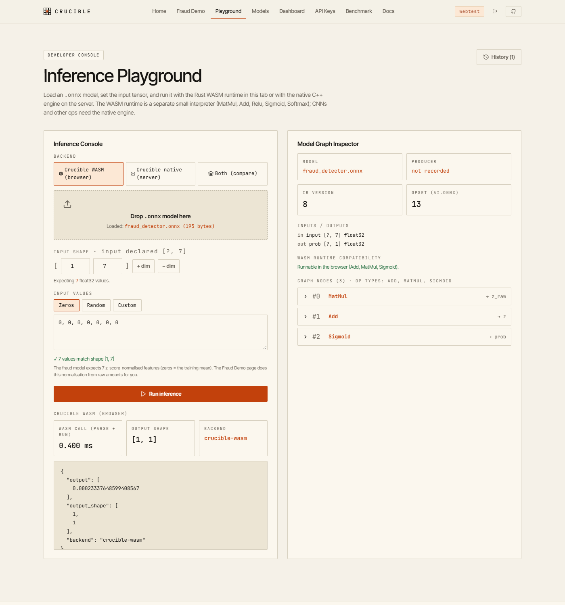
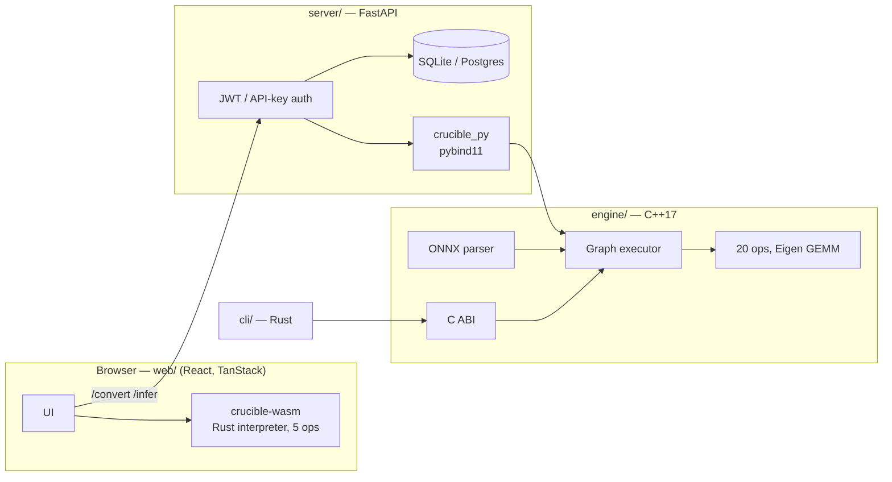

# Crucible — ONNX Inference Engine

[](https://github.com/tanmay-alpha/onnx-inference-engine/actions/workflows/ci-engine.yml)
[](https://github.com/tanmay-alpha/onnx-inference-engine/actions/workflows/ci-rust.yml)
[](https://github.com/tanmay-alpha/onnx-inference-engine/actions/workflows/ci-web.yml)

Crucible is an ONNX inference engine written from scratch in C++17, together
with the code that turns it into a small model-serving product:

* a **native engine** with a hand-written protobuf parser, a graph executor
  and 20 operators, checked against ONNX Runtime on real models;
* a **FastAPI service** where users upload ONNX models, inspect them and run
  inference on the native engine through pybind11;
* a **Rust CLI** over the engine's C ABI;
* a **browser runtime**: a separate, much smaller pure-Rust interpreter
  compiled to WebAssembly that runs the demo fraud model client-side.

It is a learning and portfolio project. It is correct on the models it
supports and honest about what it doesn't support, but it is **not fast**: it
is single-threaded and several times slower than ONNX Runtime (see
[Benchmarks](#benchmarks)).

**Live demo:** <https://crucible-ivory-three.vercel.app> serves the frontend,
which includes the in-browser WASM fraud demo and playground. The hosted API
isn't deployed yet (see [Deployment](#deployment)), so the server-backed
pages show "backend offline".



## Architecture



Details: [docs/ARCHITECTURE.md](docs/ARCHITECTURE.md).

### What I wrote vs. what is third-party

| Written for this project | Third-party |
|---|---|
| Protobuf wire-format parser for ONNX (no libprotobuf) | Eigen 3.4 (dense matrix multiply) |
| Graph executor: topological order, zero-copy weights, intermediates freed after last use, static support checks | pybind11, GoogleTest |
| Operators: Conv (im2col + GEMM, 1×1 and depthwise fast paths), pooling, BatchNorm, numpy-broadcast Add, Softmax, Gemm, … | ONNX Runtime and `onnx`, used only as the test reference and validator |
| C ABI, Rust CLI, Rust/WASM interpreter | FastAPI, SQLAlchemy, React, wasm-bindgen |
| API: auth, model ownership, upload validation, limits | |

## Supported ONNX operators

**Native engine (20):** Add, AveragePool, BatchNormalization, Concat, Conv,
Dropout, Elu, Flatten, Gelu, Gemm, GlobalAveragePool, Identity, LeakyRelu,
MatMul, MaxPool, Relu, Reshape, Sigmoid, Softmax, Tanh.

The following are **rejected with an error that names the node and the
attribute**, rather than being computed incorrectly:

* other operators and non-default domains;
* `dilations ≠ 1`, asymmetric `pads`, `auto_pad=SAME_*`, `ceil_mode`, and 3-D or 1-D windows;
* MaxPool `Indices` output, BatchNorm training mode;
* MatMul on tensors that aren't rank 2;
* non-float32 graph inputs, initializers stored as external data, and inputs that contradict the model's declared static shape.

Semantics that depend on the opset are handled: Softmax before and after
opset 13, Gelu `approximate`, and AveragePool `count_include_pad`. Only the
first graph output is returned.

**WASM runtime (5):** MatMul, Add, Relu, Sigmoid, Softmax. That's enough for
the fraud model but not for any CNN, and the UI says so.

### Models verified against ONNX Runtime

| Model | Opset | Result |
|---|---|---|
| `models/fraud/fraud_detector.onnx` (MatMul → Add → Sigmoid) | 13 | max abs diff ≤ 1e-5 |
| `models/resnet18.onnx` (ONNX model zoo) | 7 | rtol/atol 1e-3, same top-1 |
| `models/mobilenet_v2.onnx` (ONNX model zoo) | 7 | rtol/atol 1e-3, same top-1 |
| 67 single-operator graphs (broadcasting, groups, padding, axes, opsets) | 11–20 | rtol 1e-4, atol 1e-5 |

These are all in `engine/tests/python/test_parity.py`. Models that aren't
listed haven't been tested.

## Testing

| Suite | What it checks | Count |
|---|---|---|
| `ctest` (GoogleTest) | Tensor, parser, each operator, executor | 143 |
| `engine/tests/python/test_parity.py` | Native engine vs ONNX Runtime | 70 |
| `server/tests` | API, auth, ownership, limits; `/infer` output vs onnxruntime | 61 |
| `wasm/` `cargo test` | WASM kernels and 12 ORT-generated fixtures | 22 |
| `cli/` `cargo test` | CLI argument handling | 2 |

CI ([`ci-engine.yml`](.github/workflows/ci-engine.yml)):

* builds the engine and Python module on Ubuntu (GCC, `-Werror`) and Windows (MSVC);
* runs `ctest` and the parity suite on both;
* on Linux, also runs the server tests against the **real** native module (`CRUCIBLE_REQUIRE_NATIVE=1`, so a missing build fails instead of skipping), then builds and smoke-tests the CLI.

`ci-rust.yml` runs the WASM tests and clippy; `ci-web.yml` runs type-check,
lint and build.

## Benchmarks

The numbers come from `web/public/benchmarks/results.json`, written by
`python benchmarks/run_all.py`. The method, environment and full table are in
[docs/BENCHMARKS.md](docs/BENCHMARKS.md).

Median latency in ms, batch 1, i7-14650HX laptop, Docker (WSL2), 20 warmup +
200 timed calls:

| Model | Crucible (portable, 1 thread) | ONNX Runtime (1 thread) | ONNX Runtime (default threads) |
|---|---:|---:|---:|
| ResNet18 | 107.6 | 26.9 | 5.9 |
| MobileNetV2 | 48.8 | 8.1 | 2.2 |

That makes Crucible **4.0× (ResNet18) and 6.0× (MobileNetV2) slower** than
single-thread ONNX Runtime, and 18–22× slower than ORT's default thread pool.
Its outputs match ORT within 1.4e-5 with the same top-1 class. Engine
optimisations in this repo took ResNet18 from 169 ms to about 100 ms and
MobileNetV2 from 196 ms to about 50 ms: weights are no longer copied per run,
conv results are written straight to the output, and 1×1 and depthwise convs
have fast paths. The tiny fraud MLP runs in microseconds on every runtime,
so those numbers measure call overhead, not kernel speed.

## Quick start (Linux / macOS)

```bash
git clone https://github.com/tanmay-alpha/onnx-inference-engine.git
cd onnx-inference-engine
git submodule update --init --depth 1 engine/third_party/eigen \
    engine/third_party/googletest engine/third_party/pybind11

# Engine, tests and Python module
cmake -S engine -B build/release -G Ninja -DCMAKE_BUILD_TYPE=Release \
      -DCRUCIBLE_ENABLE_TESTS=ON -DCRUCIBLE_ENABLE_PYTHON_BINDINGS=ON \
      -DCRUCIBLE_BUILD_SHARED=ON
cmake --build build/release
ctest --test-dir build/release --output-on-failure

pip install numpy onnx onnxruntime pytest
CRUCIBLE_PY_DIR=build/release/python python -m pytest engine/tests/python/test_parity.py
```

`make install-engine`, `make test-engine` and `make test-server` wrap these
steps.

### Windows

Install **Visual Studio 2022 Build Tools** (the "Desktop development with C++"
workload), CMake ≥ 3.25 and Python 3.11. Then, from a *Developer PowerShell*:

```powershell
cmake -S engine -B build\release -DCRUCIBLE_ENABLE_TESTS=ON -DCRUCIBLE_ENABLE_PYTHON_BINDINGS=ON
cmake --build build\release --config Release
ctest --test-dir build\release -C Release --output-on-failure
$env:CRUCIBLE_PY_DIR = "build\release\python\Release"
python -m pytest engine\tests\python\test_parity.py
```

The same steps run in CI on `windows-latest`. If you don't have the C++
toolchain, run the Linux steps in Docker (`python:3.11-bookworm` plus
`cmake ninja-build g++`). The WASM package builds without MSVC through the
GNU toolchain:
`rustup run stable-x86_64-pc-windows-gnu wasm-pack build wasm --release --target web --out-dir ../web/public/wasm`.

### Python API

```python
import numpy as np, crucible_py

m = crucible_py.load_model("models/resnet18.onnx")
print(crucible_py.check_model(m))          # [] -> every node is supported
print(crucible_py.get_model_info(m)["inputs"])
# [{'name': 'data', 'elem_type': 1, 'shape': [-1, 3, 224, 224]}]
y = crucible_py.run(m, {"data": np.random.rand(1, 3, 224, 224).astype(np.float32)})
print(y.shape)                              # (1, 1000)
```

### API server

```bash
pip install -r server/requirements.txt -r server/requirements-dev.txt
PYTHONPATH=build/release/python:. uvicorn server.main:app --port 8000
```

```bash
API=http://localhost:8000
curl -s -X POST $API/auth/register -H 'content-type: application/json' \
     -d '{"email":"me@example.com","password":"correct-horse-1"}'
TOKEN=$(curl -s -X POST $API/auth/login -H 'content-type: application/json' \
     -d '{"email":"me@example.com","password":"correct-horse-1"}' | jq -r .access_token)

# Upload: the model is validated and its inputs/opset/unsupported nodes are reported
ID=$(curl -s -X POST $API/convert -H "Authorization: Bearer $TOKEN" \
     -F model_file=@models/fraud/fraud_detector.onnx | jq -r .onnx_model_id)

# Inference on the native engine
curl -s -X POST $API/infer -H "Authorization: Bearer $TOKEN" -H 'content-type: application/json' \
     -d "{\"model_id\":\"$ID\",\"input\":[0.1,0.2,0.3,0.4,0.5,0.6,0.7],\"input_shape\":[1,7]}"
# {"model_id":"…","output":[…],"output_shape":[1,1],"inference_time_ms":…,"backend":"crucible-native",…}
```

`inference_time_ms` measures only the engine call; network time isn't
included. If the native module isn't available, `/infer` returns **503**.
There is no fallback that fakes results. Endpoint reference:
[docs/API_REFERENCE.md](docs/API_REFERENCE.md).

### Web app

```bash
cd web && npm ci
VITE_API_URL=http://localhost:8000 npm run dev
```

### CLI

```bash
cd cli && CRUCIBLE_LIB_DIR=../build/release cargo build --release
export LD_LIBRARY_PATH=../build/release
./target/release/crucible info --model ../models/resnet18.onnx
./target/release/crucible benchmark --model ../models/resnet18.onnx --input input.json --runs 50
```

## Deployment

* **Frontend (Vercel):** project `crucible`, built from `web/` on every push
  to `main` (`vercel.json`). Set `VITE_API_URL` to the API URL; it is baked in
  at build time.
* **API (Render):** `render.yaml` defines `crucible-onnx-api`, which builds
  `server/Dockerfile` (a portable engine build that is checked to import at
  build time). It needs `DATABASE_URL` (Postgres) and generates a JWT secret.
  On the free plan, uploaded model files live on ephemeral disk, so they are
  lost on restart, and `/infer` then returns 410 until the model is uploaded
  again.

## Engineering trade-offs

* **Hand-written protobuf parser instead of libprotobuf.** The build stays
  small, needs no `protoc`, and adds no protobuf/abseil dependency. The cost
  is that only the ONNX fields the engine needs are decoded.
* **Interpreter, not a compiler.** There's no fusion, memory planning or
  threading. That keeps the executor short and easy to check against the spec,
  and it is the main reason Crucible is slower than ORT.
* **Reject instead of approximate.** Unsupported attributes fail loudly, both
  at upload time (`check_model`) and at run time, so a wrong result is never
  passed off as a supported one.
* **Two runtimes.** The browser runtime is a separate Rust implementation
  rather than the C++ engine compiled with Emscripten. That keeps the bundle
  under 100 KB, but its op set is much smaller, and the UI labels which
  backend produced every result.

## Repository layout

```
engine/     C++ engine, pybind11 bindings, C ABI, GoogleTest + ORT parity tests
server/     FastAPI service, Alembic migrations, tests
cli/        Rust CLI over the C ABI
wasm/       Rust/WASM interpreter + ORT fixtures
web/        React frontend (TanStack Start), deployed to Vercel
benchmarks/ Benchmark harness (results -> web/public/benchmarks/results.json)
models/     Fraud model (+ training scripts), ResNet18, MobileNetV2
docs/       Architecture, API reference, benchmark methodology
```

## License

MIT, see [LICENSE](LICENSE).
