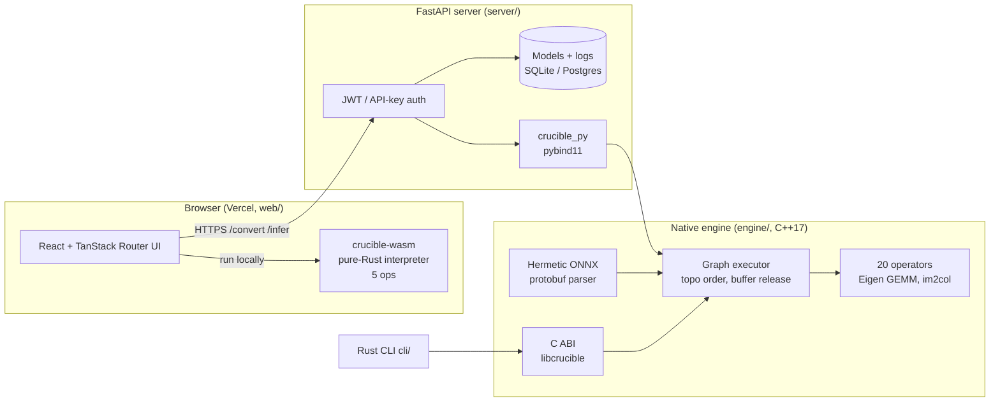

# Crucible Architecture

Crucible is a from-scratch ONNX inference engine (C++17) with three front-ends:
a Python extension used by a FastAPI model-serving API, a C ABI used by a Rust
CLI, and a separate pure-Rust interpreter compiled to WebAssembly for in-browser
demos.

## What is original vs third-party

| Component | Original code | Third-party |
|---|---|---|
| ONNX parser (`engine/src/onnx_parser.cpp`) | Protobuf wire-format reader, ModelProto/GraphProto/NodeProto/TensorProto/ValueInfoProto decoding | none (no libprotobuf) |
| Executor (`engine/src/executor.cpp`) | Kahn topological order, zero-copy tensor lookup, last-use buffer release, static `check_model` | none |
| Operators (`engine/src/ops/`) | Conv (im2col, 1x1 and depthwise fast paths), pooling, BatchNorm, activations, broadcasting Add, Concat, Reshape/Flatten | Eigen 3.4 for dense GEMM |
| Python bindings | `crucible_py` API surface | pybind11 |
| C ABI + Rust CLI | `c_api.h`, `cli/` | — |
| WASM runtime (`wasm/`) | Separate Rust ONNX parser + 5 kernels | wasm-bindgen |
| Server (`server/`) | Endpoints, auth, ownership, validation | FastAPI, SQLAlchemy, onnx (checker) |
| Tests | GoogleTest unit tests, ORT parity suite | GoogleTest, ONNX Runtime as the numerical reference |

## Native engine

* **Tensor**: float32, row-major, owns a `std::vector<float>`; rank-0 scalars supported. Int64 initializers are kept separately (shape inputs for Reshape).
* **Parser**: reads `opset_import`, node `domain`, graph input/output types and shapes. Rejects external-data initializers; records unsupported-dtype initializers so failures name the tensor.
* **Executor**: validates graph inputs (presence, float32, declared static dims), orders nodes once per run, resolves initializers and caller inputs in place, owns only intermediates and frees each after its last consumer. `Model` is never mutated, so concurrent runs are safe; the Python binding releases the GIL.
* **Unsupported features are rejected, never approximated**: non-default domains, dilations ≠ 1, asymmetric pads, `auto_pad=SAME_*`, `ceil_mode`, MaxPool indices, BatchNorm training mode, non-float inputs. `check_model()` reports the same reasons statically at upload time.
* **Opset-dependent semantics** implemented: Softmax (opset < 13 2-D coercion vs ≥ 13 per-axis), Gelu `approximate`, AveragePool `count_include_pad`.

Supported ops: Add, AveragePool, BatchNormalization, Concat, Conv, Dropout,
Elu, Flatten, Gelu, Gemm, GlobalAveragePool, Identity, LeakyRelu, MatMul,
MaxPool, Relu, Reshape, Sigmoid, Softmax, Tanh. MatMul is rank-2 only.

## Execution backends and honesty rules

* The API runs inference only through `crucible_py`. If the native module is unavailable the server answers `503` and `/health` reports `engine: "unavailable"`. There is no numpy fallback.
* Every inference response carries `backend`, and `inference_time_ms` is engine time measured around the native call (network time is excluded). The web UI measures the HTTP round trip separately.
* The WASM runtime is a different implementation with a much smaller op set (MatMul, Add, Relu, Sigmoid, Softmax). It runs the fraud model, not the CNNs, and the UI labels it as "Crucible WASM (browser)".

## Verification

* `engine/tests/*.cpp`: GoogleTest unit tests per operator, parser, executor.
* `engine/tests/python/test_parity.py`: builds single-op graphs with `onnx.helper` and runs the real models (fraud MLP, ResNet18, MobileNetV2), comparing against ONNX Runtime CPU. Tolerances are rtol 1e-4 / atol 1e-5 for single ops and rtol 1e-3 / atol 1e-3 plus a top-1 match for full CNNs. The suite fails, rather than skipping, if the native module is missing.
* CI (`.github/workflows/ci-engine.yml`) builds the engine and bindings on Linux (GCC) and Windows (MSVC), runs both suites, and runs the server tests against the real native module.

## Known limitations

* Single-threaded, float32 only, no graph fusion or memory planning. It is several times slower than ONNX Runtime; see [BENCHMARKS.md](BENCHMARKS.md).
* Only the first graph output is returned.
* Uploaded models on the free Render plan live on ephemeral disk.
